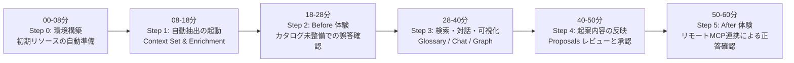
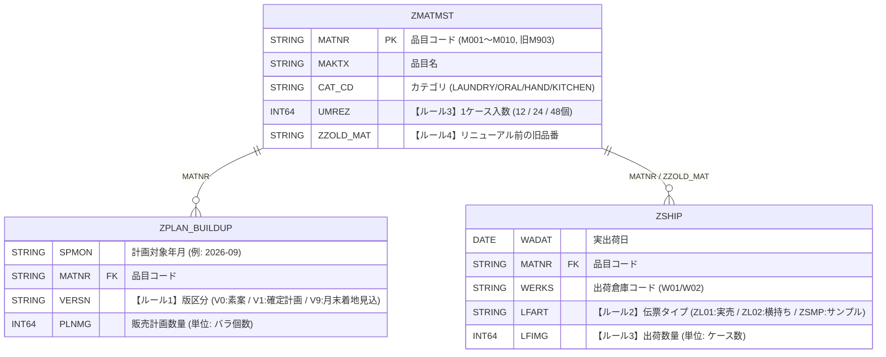
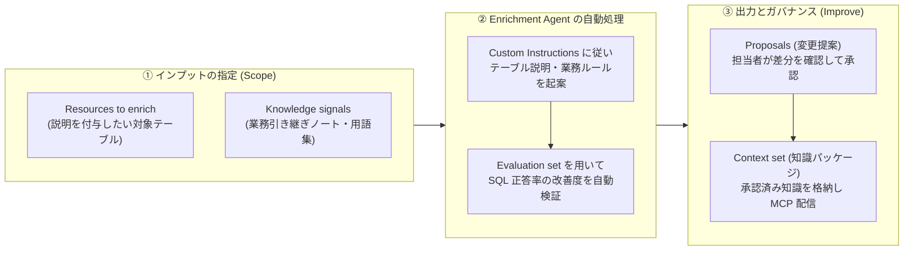

# Knowledge Catalog & Knowledge Studio 60分ハンズオン手順書

**散在する業務の暗黙知を「AI エージェントのためのコンテキストエンジン」として整備・活用する実践ワークショップ**

* **所要時間**: 約 60 分
* **動作環境**: Google Cloud プロジェクト ＋ **Google Cloud Shell**（ローカル PC への環境構築は不要です）
* **想定コスト**: 1 回あたり約 \$0.05〜\$0.10（約 10〜15 円）未満（終了後に `cleanup.sh` で作成リソースを一括削除可能）

### 事前準備・前提条件
本ハンズオンを開始する前に、以下の条件を満たす検証用 Google Cloud プロジェクトをご用意ください。
1. **課金アカウントのリンク**: 対象プロジェクトに有効な請求先アカウント（Billing Account）がリンクされていること。
2. **実行ユーザーの権限**: `setup.sh` が API の有効化、サービスアカウントの作成と IAM ロール付与、BigQuery / Cloud Storage / Dataplex リソースの作成を行うため、実行ユーザーに対象プロジェクトで以下の IAM ロールが付与されていること。
   * `roles/editor`（編集者）
   * `roles/resourcemanager.projectIamAdmin`（プロジェクト IAM 管理者）
   * `roles/iam.serviceAccountAdmin`（サービス アカウント管理者）
   * `roles/storage.admin`（Storage 管理者）

---

## 0. 本ハンズオンの目的と全体タイムテーブル

企業データに生成 AI（Text-to-SQL や自律型データ分析エージェント）を接続した際に多く発生する課題は、モデルの推論性能不足ではなく、**業務コンテキスト（版管理ルール・単位換算・KPI 定義）の欠落による「サイレント・ハルシネーション（一見もっともらしい誤集計）」** です。

本ハンズオンでは、日用品メーカーの需給計画（SCM）業務を題材に、**Knowledge Catalog** と **Knowledge Studio** を用いて業務メタデータを整備し、リモート MCP サーバー経由で AI エージェントの回答精度を改善する一連のプロセスを体験します。



### 題材とするミニ SCM データセット（`kc_handson_scm`）の構造と 4 つの業務ルール

基幹システム（SAP 等）から連携されたデータを想定し、**物理カラム名のみ（論理名・列説明なし）** で構成された 3 つのテーブルを使用します。このデータセットには、テーブル内の値を `SELECT *` で参照しただけでは判別できない **4 つの業務ルール（暗黙知）** が含まれています。



1. **ルール①（計画バージョンの選択ルール）**: `VERSN` の `'V9'` は「月末着地見込み（Forecast）」であり、計画値ではありません。公式の予実評価では **`VERSN = 'V1'`（月初確定計画）** を使用する規定ですが、コンテキストがない AI は「数値が大きい `'V9'` が最新版である」と推測したり全版を合算したりして誤集計します。
2. **ルール②（出荷伝票タイプの絞り込みルール）**: `LFART` には `'ZL01'`（得意先向け実売出荷）のほか、`'ZL02'`（倉庫間横持ち転送）や `'ZSMP'`（無償サンプル出荷）が含まれています。**`'ZL01'` のみに絞り込まない場合、出荷実績が過大計上**されます。
3. **ルール③（計画と出荷の単位換算ルール）**: 販売計画 `PLNMG` は **バラ個数**、出荷実績 `LFIMG` は **ケース数** で記録されているため、品目マスタのケース入数（`ZMATMST.UMREZ`）を乗じて単位を揃える必要があります。
4. **ルール④（リニューアル品目の新旧品番合算ルール）**: `ZZOLD_MAT` に旧品番が設定されているリニューアル品目（`M003` ← 旧品番 `M903`）は、旧品番の実売出荷分を新品番に合算して評価する規定です（合算時の乖離率は `0.0%` ですが、未合算の場合は `-70%` の大幅未達と誤判定されます）。

---

## Step 0（00:00 - 00:08）：環境確認と初期リソースの構築

### 0-1. Cloud Shell の起動とセットアップの実行
1. [Google Cloud コンソール](https://console.cloud.google.com/) を開き、ハンズオンを実施するプロジェクトを選択します。
2. 画面右上の **「Cloud Shell をアクティブにする」** アイコン（`>_`）をクリックします。
3. Cloud Shell のターミナルで以下のコマンドを順に実行し、資材の取得・事前チェック・環境構築を行います。

```bash
# 1. ハンズオン資材の取得とディレクトリ移動（取得済みの場合は cd のみ実行）
git clone https://github.com/noykmgi/kc-scm-handson.git
cd kc-scm-handson

# 2. 対象プロジェクト ID の設定（YOUR_PROJECT_ID をご自身のプロジェクト ID に置き換えてください）
gcloud config set project YOUR_PROJECT_ID

# 3. 事前環境チェック（約10秒：「対象プロジェクト」が設定した ID になっていることを確認）
bash preflight_check.sh

# 4. 初期環境の自動構築（所要時間：約2〜3分）
bash setup.sh

# 5. 以降のステップで使用する Python 仮想環境の有効化
source .venv/bin/activate
```

> [!NOTE]
> 本キットの各スクリプトは **`gcloud config` のプロジェクト設定を優先** して参照します（Cloud Shell が起動時に自動設定する環境変数 `GOOGLE_CLOUD_PROJECT` はフォールバックとしてのみ使用します）。コンソール画面上の選択プロジェクトと異なるプロジェクトで実行する場合も、上記の `gcloud config set project` で切り替え可能です。環境変数で明示的に固定したい場合は `export HANDSON_PROJECT_ID=YOUR_PROJECT_ID` を設定してください。

### 0-2. `setup.sh` で作成されるリソース
* 必要な Google Cloud API の有効化、および Knowledge Studio Enrichment 実行用サービスアカウント（`kc-handson-enrichment-sa`）の作成と IAM ロール付与
* BigQuery データセット `kc_handson_scm`（3 テーブル・計約 340 行）の作成と、正解確認用クエリ（Golden SQL）の検証出力
* Cloud Storage バケットへの **「需給調整会議 業務引き継ぎノート（`scm_operation_notes.md`）」** および **「評価データセット（`scm_eval.jsonl`）」** の配置
* 初期 Business Glossary（`kc-handson-scm-glossary`）および **AWS RDS (MySQL) 想定カスタムエントリ** 1 件の作成

> [!IMPORTANT]
> `setup.sh` の完了時にターミナル末尾へ表示される **【Knowledge Studio 設定パラメータ一覧】** には、ご自身のプロジェクト ID が反映された設定値が出力されています。次の Step 1 でそのままコピー＆ペーストして使用しますので、ターミナル画面を閉じずに進めてください。

---

## Step 1（00:08 - 00:18）：【Knowledge Studio】Context Set の作成と Enrichment タスクの起動

Knowledge Studio の **Enrichment Agent** は、業務手順書や用語集などの関連資料を読み込み、テーブルやカラムの説明文・業務ルールを自動起案したうえで、評価データセットを用いた精度検証までを自動実行する機能です。

バックグラウンド処理（資料読解 → メタデータ起案 → 評価セットでの検証）の完了には **通常 20〜60 分程度** を要するため、最初にタスクを起動してバックグラウンドで実行させながら、以降のステップを進めます。

### 設定項目の全体像

タスク作成ウィザードは **4 つのステップ（Define → Scope → Improve → Run）** で構成されています。各項目の役割は以下の通りです。



| ウィザード画面 | 設定項目名 | 概要 | 設定の目的・役割 |
| :--- | :--- | :--- | :--- |
| **1. Define**<br>*(目的の定義)* | **Custom Instructions**<br>*(ドキュメント上の旧称: Goal)* | **AI への作業指示書** | どの業務領域の分析に向け、どのようなルール（版管理・単位換算など）を重点的に抽出・文書化するかを自然言語で指定します。 |
| **2. Scope**<br>*(対象と参照元の指定)* | **Context set** | **業務領域別の知識パッケージ** | 業務領域（今回は「SCM 需給計画」）ごとに、整備したテーブル定義や業務ルールをまとめる論理コンテナです。AI エージェントへ参照範囲を限定して知識を提供する単位となります。 |
| 〃 | **Resources to enrich** | **メタデータ整備対象のテーブル** | 列説明が未設定の BigQuery テーブル（今回は 3 テーブル）を指定します。 |
| 〃 | **Knowledge signals** | **参照させる業務ルール資料** | テーブル内の数値からは判別できない社内規定が記載された **Cloud Storage 上の業務メモ** や **用語集（Glossary）** を読み取り専用で指定します（本番運用では Google Drive / SharePoint / Confluence / GitHub 等も接続可能です）。 |
| **3. Improve**<br>*(品質評価と公開設定)* | **Evaluation set** | **精度検証用のテストセット** | 「想定される質問」と「正解 SQL」のペア（`.jsonl`）です。生成したメタデータによって **SQL の正答率が実際に向上したか** をエージェント自身が定量評価します。 |
| 〃 | **Enable auto-publish** | **自動公開の有効化** | 有効にすると評価合格時にカタログへ即時反映されます。本ハンズオンでは **無効（オフ）** にし、生成された提案を人間が差分レビューして承認（Approve）するガバナンス運用を確認します。 |
| **4. Run**<br>*(実行権限とスケジュール)* | **Run as > Service account** | **AI 実行用の専用サービスアカウント** | 許可されたリソース以外へアクセスしないよう、`setup.sh` で作成した最小権限の専用サービスアカウントを指定します。選択時に Policy Troubleshooter による権限確認が自動実行されます。 |
| 〃 | **Trigger** | **実行スケジュール** | 本番環境では日次・週次の定期実行によりスキーマ変更等へ追従させますが、今回は即時実行するため **On demand（手動実行）** を選択します。 |

---

### 操作手順

1. ブラウザで **[Knowledge Studio](https://console.cloud.google.com/dataplex/studio)** を開きます（画面上部で対象プロジェクトが選択されていることを確認してください）。
2. 左側ナビゲーションから **「Enrichments」** を選択し、**「+ Create enrichment task」** をクリックします。
3. **【1. Define ペイン】** に以下を入力し、**Continue** をクリックします。
   * **Display name**: `SCM Plan vs Actual Enrichment`
   * **Task ID**: `scm-plan-actual-enrichment`（自動入力された値のままでも構いません）
   * **Custom Instructions**（上限 4,096 文字。以下のテキストをコピー＆ペーストしてください）:
     ```text
     日用品 SCM データセット（kc_handson_scm）を対象に、販売計画と出荷実績の予実乖離分析を行う Text-to-SQL エージェント向けの業務コンテキストを整備する。SAP 由来の物理名を持つテーブル・カラムの業務的な意味、集計時に適用すべき業務ルール（計画バージョンの選択、出荷伝票の絞り込み、単位換算、品番統合）、および予実乖離率の標準計算式を、参照資料に基づいて文書化すること。

     出力言語ルール（最重要）:
     - 説明文・カラム定義・業務ルール・注意点（Traps）・引用根拠の文章は、すべて自然な日本語で記述すること。
     - ただし、Markdown の H2 見出しのみは、自動の構造チェック・引用チェックを通過させるため、必ず次の英語表記をそのまま使用すること（翻訳しないこと）: `## Purpose`, `## Columns & Metrics`, `## Lineage`, `## Usage`, `## Sample SQL`, `## Definitions`, `## How to Query`, `## Method`, `## Traps`, `## Related Pages`, `## Source References`
     ```

> [!NOTE]
> **H2 見出しのみ英語表記を指定している理由（Preview 仕様に関する補足）**
> Enrichment Agent はメタデータ生成時に構造チェックおよび引用元の検証を自動実行しており、内部パーサーが `## Purpose` や `## Source References` などの英語 H2 見出しを参照しています。指示文自体は日本語で問題ありません（日本語指示で H2 見出しが英語のまま維持され、本文が日本語で生成されることを実機確認済みです）。なお、ナレッジ文書のタイトルやサンプル SQL の 1 行要約など一部のシステム生成項目は、指示言語に関わらず英語で出力されます。

4. **【2. Scope ペイン】** に、`setup.sh` 完了時に出力された設定パラメータ一覧の値を入力し、**Continue** をクリックします（`<PROJECT_ID>` の部分はご自身のプロジェクト ID に置換された値を入力してください）。
   * **Context set**: **「Create new context set」** をクリックし、以下の内容で新規作成・選択します。
     * Display name: `SCM Hands-on Context Set`
     * Context set ID: `kc-handson-scm-context`
     * Location: `us-central1`（※対象テーブルおよび用語集とリージョンを揃えるため、必ず `us-central1` を選択してください）
   * **Resources to enrich**: 設定パラメータ一覧に出力された `//bigquery.googleapis.com/...`（3 テーブル分・カンマ区切り）を貼り付けるか、**Browse** から `kc_handson_scm` 配下の 3 テーブル（`ZMATMST`, `ZPLAN_BUILDUP`, `ZSHIP`）を選択します。
   * **Knowledge signals**:
     * **Cloud Storage buckets, folders, or files**: 設定パラメータ一覧の `<PROJECT_ID>-kc-handson-docs` を入力して <kbd>Enter</kbd> キーを押します（または **Browse** から選択します。このバケット内に業務引き継ぎノート `scm_operation_notes.md` が格納されています）。
     * **Glossaries**: **Browse** をクリックし、`日用品SCM 需給計画用語集 (Hands-on)`（`kc-handson-scm-glossary`）を選択します。
5. **【3. Improve ペイン】** に以下を設定し、**Continue** をクリックします。
   * **Evaluation set**: 設定パラメータ一覧の `gs://<PROJECT_ID>-kc-handson-eval/scm_eval.jsonl` を入力します。
   * **Publishing**: **「Enable auto-publish」のチェックを外します（オフ）**。
6. **【4. Run ペイン】** に以下を設定し、**Create** をクリックします。
   * **Run as** > **Service account**: 設定パラメータ一覧の `kc-handson-enrichment-sa@<PROJECT_ID>.iam.gserviceaccount.com` を選択します。
     * *※選択すると自動で権限チェック（Policy Troubleshooter）が実行されます。`setup.sh` 実行済みであればそのまま通過しますが、権限不足の警告が表示された場合は画面上の **「Grant all」** をクリックして付与してください（`Grant access to BigQuery query history` はオフのままで問題ありません）。*
   * **Trigger**: **On demand** を選択します。
7. タスク詳細画面が開いたら、画面右上の **「Run now」** をクリックします。`Jobs` タブにステータス `Running` のジョブが表示されたことを確認し、次の Step 2 へ進みます。

---

## Step 2（00:18 - 00:28）：【Before 体験】カタログ未整備状態での AI エージェントの挙動確認

バックグラウンドで Enrichment タスクを実行している間に、業務メタデータが整備されていない状態で AI エージェントに集計を依頼した場合の挙動を確認します。

Cloud Shell に戻り、以下のコマンドを実行します。

```bash
python ask_agent.py --mode plain
```

### 確認ポイント
* エージェントはテーブル一覧・スキーマ・サンプル行を参照して SQL を組み立てますが、実行結果の末尾に **`❌ 誤答検知 (業務ルールの欠落による集計ミス)`** と表示されます。
* **出力された SQL と回答内容を確認してください**:
  1. `ZPLAN_BUILDUP.VERSN` において、番号が最も大きい `'V9'`（月末着地見込み）を確定版と推測して選択している、あるいは全バージョンを合算していないか。
  2. `ZSHIP.LFART` の伝票区分（`'ZL02'` 横持ち転送・`'ZSMP'` 無償サンプル）を除外せず合算し、`M004` や `M006` を上位品目として誤検出していないか。
  3. リニューアル品目 `M003` に対して旧品番 `M903`（`ZZOLD_MAT`）の出荷分を合算せず、本来は乖離 `0.0%` であるにもかかわらず大幅未達と判定していないか。
* **まとめ**: 高性能なモデルであっても、またテーブル内のレコードを何度参照しても、**企業固有の業務定義（オントロジー）は実データの値のみからは導出できません**。これが業務データ分析における「サイレント・ハルシネーション」の主要因です。

---

## Step 3（00:28 - 00:40）：【Knowledge Studio】横断検索・Glossary・New chat & Context Graph の体験

続いて、Knowledge Catalog および Knowledge Studio が提供する検索・用語管理・対話型探索機能をコンソール UI で確認します。

### 3-1. マルチクラウド資産を含む横断検索（2分）
1. コンソールの **[Knowledge Catalog > Search](https://console.cloud.google.com/dataplex/dp-search)** を開きます。
2. 検索バーに `AWS` または `特売` と入力して検索します。
3. BigQuery テーブルに加えて、**`promo_db.promo_schedule (AWS RDS MySQL)`** が検索結果に表示されることを確認します。実データを Google Cloud へ複製しなくても、他クラウド側のメタデータを単一カタログ上で統合管理・意味付けし、MCP 経由で AI エージェントから参照させることが可能です。
   * *※補足：本ハンズオンでは AWS アカウント不要で体験できるよう、`setup.sh` 内でカスタムエントリ API を用いてメタデータを登録しています。実運用では **[Managed Connectors](https://docs.cloud.google.com/knowledge-catalog/docs/connectors)**（MySQL / PostgreSQL / SQL Server / Oracle / dbt Core 等）、**BigQuery Omni**（Amazon S3）、または **Managed Connectivity パイプライン** を利用して外部データソースからメタデータを自動収集します。*

### 3-2. Business Glossary（ビジネス用語集）とテーブルカラムの紐付け（3分）

**この操作の目的**: 用語集に定義されたビジネス用語（「確定販売計画とは何か」）と、物理テーブルの特定カラム（`ZPLAN_BUILDUP.VERSN`）をリンクさせます。これにより、物理名が暗号的であっても、カタログ検索・Context Graph・MCP 経由のエージェント参照において「このカラムがどの業務概念に対応するのか」を正確に辿れるようになります。

1. 左側ナビゲーションから **[Glossaries](https://console.cloud.google.com/dataplex/dp-glossaries)** を開き、`日用品SCM 需給計画用語集 (Hands-on)` をクリックします。
2. 用語一覧から **`確定販売計画 (VERSN=V1)`** をクリックして詳細画面を開きます。
3. 画面内の **「Related entries」** セクションにある **`+ Add`** ボタンをクリックし、**Add Related Entries** パネルを開きます。
4. **Filter** 欄に `ZPLAN_BUILDUP`（または `VERSN`）と入力し、一覧に表示された `ZPLAN_BUILDUP` テーブル（および `Column Name` が `VERSN` の行）にチェックを入れて、パネル下部の **`Add`** をクリックします。
5. `Related entries` 一覧に対象テーブル／カラムが追加されたことを確認します。

### 3-3. Knowledge Studio [New chat] と [Context Graph] による関係性の可視化（7分）
1. 左側ナビゲーションから **[Knowledge Studio](https://console.cloud.google.com/dataplex/studio)** に戻り、**「New chat」** を開きます。
2. チャット入力欄の下にある **Explore data across** で現在のプロジェクトが選択されていることを確認します（必要に応じて **Thinking level**［Low / Medium / High］も変更可能です）。
3. 以下のプロンプトを入力して送信します。

```text
このプロジェクト内に存在する SCM 関連のデータセット・テーブル・ビジネス用語集を教えてください。
```

4. 回答下部に表示される **「Add to graph」** をクリックする（または **Matching assets** を展開してテーブルカードを選択し、右上の **Show graph panel** アイコンをクリックする）と、検出されたアセットが画面右側の **Context Graph** キャンバスに追加されます。
5. Context Graph 上で、データセット・テーブル・先ほど紐付けた Glossary 用語がノードとエッジ（関係線）で結ばれている構造を視覚的に確認します。また、回答内の **Thinking** を展開すると、エージェントが内部で実行したカタログ検索プロセスを確認できます。

---

## Step 4（00:40 - 00:50）：【Knowledge Studio】AI 起案（Proposals）のレビューと承認

Step 1 で起動した Enrichment タスクのステータスに応じて、以下の **パターン A** または **パターン B** の手順でカタログおよび Context Set へメタデータを反映します。

### パターン A：Enrichment ジョブがまだ `Running`（実行中）の場合【60分ハンズオンの標準進行】
Public Preview 仕様上、Enrichment ジョブの完了には通常 20〜60 分程度を要します。ワークショップの時間内に次の Step 5 へ進むため、ジョブの完了を待たずに以下のスクリプトを実行してください。承認（Approve）完了後と同等のテーブル Overview・業務ルール・Glossary 紐付け・Context Set が **約 10 秒でカタログへ反映** されます。

```bash
python fast_forward_kc.py
```
*※バックグラウンドで実行中の Enrichment ジョブ自体もそのまま継続されるため、ジョブ完了後に以下の「パターン B」の手順で実際の差分レビュー画面や Evaluation スコアを確認できます。*

### パターン B：Enrichment ジョブが `Succeeded`（完了）している場合【コンソールでのレビュー・承認】
1. Knowledge Studio 左側ナビゲーションの **「Enrichments」** を開き、`SCM Plan vs Actual Enrichment` > **「Jobs」** タブを選択します。
2. 完了したジョブの Run ID（または Actions メニュー > **Result**）をクリックし、**Enrichment run details** を開きます。
3. 以下の 3 つのタブで、生成されたメタデータと評価結果をレビューします。
   * **Overview タブ**: 全体の Confidence スコアを確認します。下部の **Proposals** セクションは 4 つのカテゴリ（`BigQuery tables` / `Knowledge base documents` / `Knowledge base index` / `Other changes`）に分類されており、各行の **「View proposal」** をクリックすると右側のパネルで **Changes（変更差分）** と **Preview** を確認できます。業務ノート（`scm_operation_notes.md`）から `VERSN` や `UMREZ` などのルールが日本語で抽出されていることを確認してください（鉛筆アイコンの **Edit** から手動修正も可能です）。
   * **Evaluation タブ**: 評価データセット（`scm_eval.jsonl`）に対し、メタデータ適用前後で SQL 正答率がどの程度向上したか（**Delta**）と、各テストケースの評価根拠（**Why**）を確認します。
   * **Artifacts タブ**: **Confidence scores**（Grounding / Corroboration / Source quality の 3 軸評価）を確認します。
4. 内容を確認後、**Overview** タブの **Proposals** ヘッダーにある **「Approve」** をクリックします。これにより、提案されたメタデータが正式にカタログおよび Context Set へ反映されます。

---

## Step 5（00:50 - 01:00）：【After 体験】リモート MCP（`lookup_context`）連携による正答確認

最後に、整備・承認された Knowledge Catalog のコンテキストを、フルマネージドの **リモート MCP サーバー（`https://dataplex.googleapis.com/mcp`）** 経由で外部 AI エージェントから参照し、Step 2（Before）との結果の違いを確認します。

### 5-1. リモート MCP が返却する LLM 向け YAML コンテキストの確認（3分）
Cloud Shell で以下のコマンドを実行します。

```bash
python inspect_mcp.py
```

* `search_entries` により日本語の業務キーワード（「予実乖離」「計画最新版」「ケース換算」）から関連テーブルが検索され、続く `lookup_context` の **1 回のリクエスト** で、3 テーブルのスキーマ・カラム定義・業務ルールが構造化された **LLM 向け YAML 形式** で返却されることを確認できます。

### 5-2. カタログ連携を有効化したエージェントの実行（5分）
Step 2（Before）と **同一のモデル（`gemini-3.8-flash`）・同一の質問文** に対し、Knowledge Catalog MCP 連携を有効化した `--mode kc` オプションで実行します。

```bash
python ask_agent.py --mode kc
```

### 確認ポイント（Step 2 との比較）
1. エージェントは SQL を生成する前に、`🌐 [Knowledge Catalog MCP] lookup_context` および `search_entries` を自律的に呼び出して業務ルールを取得します（手探りでサンプル行を繰り返し走査する予備クエリも削減されます）。
2. 生成された最終 SQL において、4 つの業務ルールがすべて適用されていることを確認できます。
   * `VERSN = 'V1'` による **月初確定計画の選択**
   * `LFART = 'ZL01'` による **倉庫間横持ち（`ZL02`）・無償サンプル（`ZSMP`）の除外**
   * `SUM(s.LFIMG * m.UMREZ)` による **ケース数からバラ個数への単位換算**
   * `ZZOLD_MAT` の結合による **リニューアル品目 `M003` と旧品番 `M903` の出荷合算**
3. 上位 5 品目（`M007 +50.0%`, `M002 -35.0%`, `M009 -30.0%`, `M005 +25.0%`, `M001 -20.0%`）が 1 回の集計で正確に算出され、自動採点結果が **`✅ 正解 (Golden SQL と完全一致!)`** となります。

### 参考：本番エージェント（Google ADK 等）への組み込み例
実運用システム（Cloud Run 上の Google ADK エージェントや、他クラウド上の MCP 対応エージェント等）から接続する場合、独自のカタログ取得 API クライアントを実装する必要はなく、標準の Streamable HTTP MCP クライアント設定のみで連携できます。

```python
# Google ADK (Python) から Knowledge Catalog リモート MCP サーバーへ接続する最小コード例
from google.adk.tools.mcp_tool import McpToolset, StreamableHTTPConnectionParams

kc_mcp = McpToolset(
    connection_params=StreamableHTTPConnectionParams(url="https://dataplex.googleapis.com/mcp"),
    header_provider=lambda _: {"Authorization": f"Bearer {get_access_token()}"},
    tool_filter=["search_entries", "lookup_context"],
)
```

---

## クリーンアップ手順（リソースの削除）

ハンズオン終了後、プロジェクト内に作成した BigQuery データセット・Cloud Storage バケット・サービスアカウント・Glossary・Context Set を一括削除するには、以下のスクリプトを実行してください（削除対象の一覧が表示された後、`y` の入力で削除が実行されます）。

```bash
bash cleanup.sh
```
*※コンソール UI 上で作成した Enrichment Task 自体も削除する場合は、[Knowledge Studio > Enrichments](https://console.cloud.google.com/dataplex/studio) から対象タスクを選択し、**Delete** をクリックしてください。*
